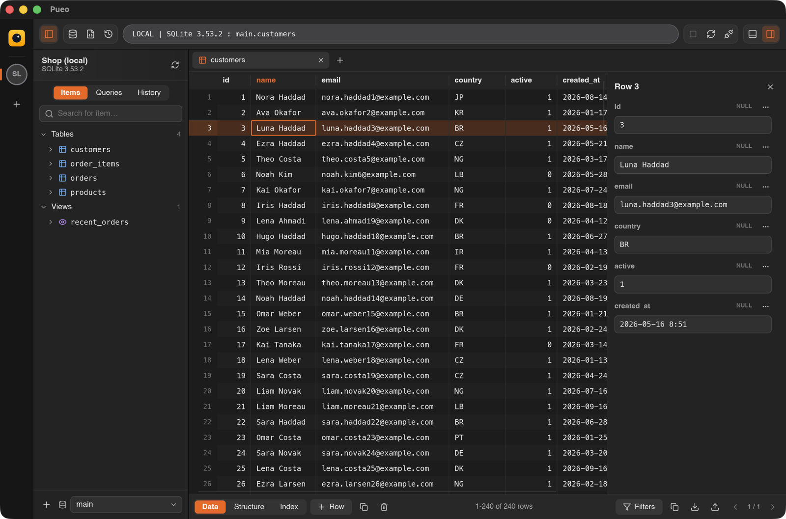
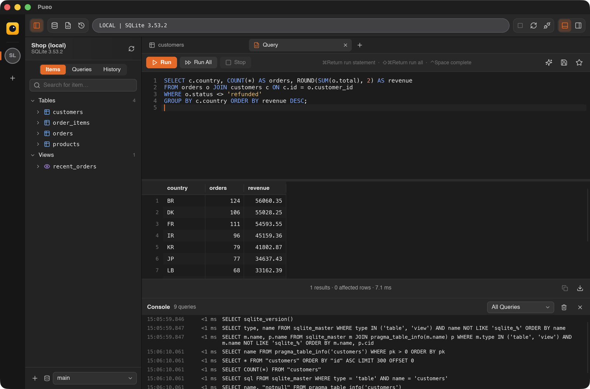
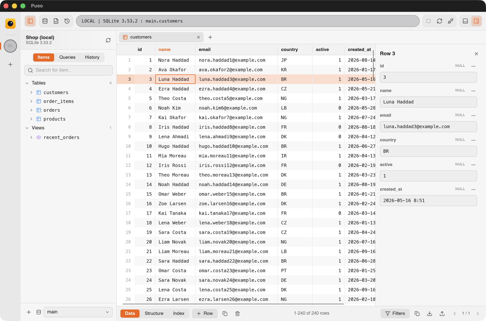
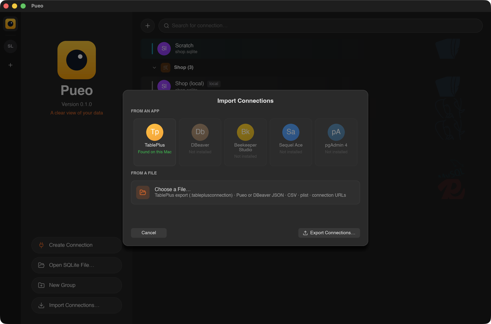

<div align="center">


# Pueo

A fast, native database client for macOS and Linux, written in Rust with a [Slint](https://slint.dev) interface.

Supports **PostgreSQL**, **MySQL / MariaDB**, **SQLite** and **Redis**.


</div>

## Screenshots

| Table browser with the row inspector | Query editor with results and the console |
| --- | --- |
|  |  |

| Light appearance | Importing connections from other apps |
| --- | --- |
|  |  |

## Features

**Home page**
- Connections in **groups** with an icon (a symbol, an emoji or your own image, copied to
  `~/.config/pueo/icons`) and a colour. Groups can be collapsed.
- Each row shows the engine, its **colour** and an **environment tag** (local / development / testing /
  staging / production); a tag colours the row when no colour is set
- **Drag and drop**: reorder connections, move them between groups, reorder groups
- Right-click a connection for Connect, Edit, Duplicate (passwords included), Move Up / Down and Delete, or a
  group to edit it. Deleting a group keeps its connections.
- Search across names, hosts, types and tags; "Open SQLite File…" connects without saving
- **⌘K** opens a quick switcher for saved and open connections

**Import and export of connections**
- Import straight from **TablePlus**, **DBeaver**, **Beekeeper Studio**, **Sequel Ace** and **pgAdmin 4**
  when they are installed; Pueo shows which ones it found
- Or from a file: a TablePlus export (`.tableplusconnection`, including password-protected ones), Pueo or
  DBeaver JSON, CSV, a plist, or a list of connection URLs (`postgres://user@host/db`)
- Pick which connections to bring in; duplicates are detected. Groups and colours carry over.
- Export your connections to a file to move them to another machine

**Connections**
- New connections start from an engine picker, then a form with SSH and TLS options
- Passwords are stored in the macOS Keychain or the desktop keyring (Secret Service). If a server asks for a
  password that isn't saved, Pueo asks for it and can remember it.
- **SSH tunnels** through the system `ssh` client, so `~/.ssh/config`, the agent and `known_hosts` all apply.
  Supports agent/default keys, password, or a specific private key with an optional passphrase.
- **Connection rail** on the left edge of the window:
  - The owl button shows your saved connections.
  - Each open connection gets a coloured badge. Click it or press ⌘1–9 to switch; each keeps its own tabs
    and state.
  - Right-click a badge for New Query / Close Connection.
  - Opening a connection that is already open switches to it.
- **Database switcher** at the bottom of the sidebar, plus a **schema switcher** for PostgreSQL
- `pueo file.db` opens a SQLite file directly

**Browsing**
- Sidebar with **Items**, saved **Queries** and **History**, and a search box
- Collapsible **Functions**, **Tables** and **Views** sections with live counts (Redis keys grouped by type).
  Tables and views expand to their columns, with a key icon on the primary key and the column type.
- Functions and procedures (PostgreSQL, MySQL) open their `CREATE` statement in a query tab
- **Pin** tables and views to the top of their section (remembered per connection and database)
- Right-click a table or view to open it (or in a new tab), open its structure, copy its name, export /
  import, clone, truncate or delete it
- Redis lists up to 50,000 keys. Beyond that a note appears, and pressing Return in the search box runs
  `SCAN MATCH` on the server.
- Tabbed table browser:
  - 300 rows per page with an exact row count
  - **Filters** panel with `column operator value` rules, or a raw SQL `WHERE` clause
  - click a column header to sort on the server
  - Data / Structure / Index views

**Editing** (tables with a primary key; Redis hash, list, set, zset and string values)
- Double-click a cell, or press Return, to edit it **in place**; Tab moves to the next cell
- Select several rows with Shift-click and ⌘-click; copy them as TSV and paste rows back in
- Add rows (⌘I), duplicate and delete rows, set NULL, all from the right-click menu too
- **Row inspector** (⇧⌘I): the selected row as a form on the right, with multi-line fields for long text
  and JSON and Set NULL per field
- Changed cells, new rows and deleted rows are highlighted, and a bar shows how many changes are pending
- **Commit** (⌘S) applies everything in one transaction. If anything fails, nothing is changed and your
  edits are kept. **Discard** throws them away.
- You're asked before paging, filtering, reloading or closing a tab would lose pending edits

**Query editor**
- SQL highlighting and line numbers
- Autocomplete of keywords, tables and columns, including `alias.column` (⌃Space opens it)
- ⌘Return runs the selection or the statement under the cursor; ⇧⌘Return runs everything
- **Stop** cancels the running query on the server: PostgreSQL cancel request, MySQL `KILL QUERY`, SQLite
  interrupt
- **History** of every query per connection, searchable, plus **saved queries** (⌘S in a query tab)
- The Redis console takes one command per line, and replies are shown as grids

**Console** (⇧⌘C): a bottom panel logging every query Pueo sends to the server, with time, duration and
errors in red. Filter by All Queries, Hide Metadata (the lookups Pueo makes by itself) or Your Queries. The
history is kept per connection (last 5000 queries).

**Data import / export**
- Export a whole table (respecting the current filter and sort) or a query result as **CSV, JSON or SQL
  INSERTs**
- Import a CSV file with a header row into a table, in one transaction; empty fields become NULL

**Appearance**: light and dark themes. By default Pueo follows the system; View → Appearance forces one or
the other, and the choice is remembered.

**Loading effect**: while a connection is working, a faint grid of memory cells appears behind the sidebar
header, lit by a slow scan wave in the connection's colour with the odd bit flipping.

## Build & run

Pueo runs on macOS and Linux. You need Rust 1.88 or newer ([rustup.rs](https://rustup.rs)) and the system
`ssh` client for SSH tunnels. The interface is written in Slint (`ui/app.slint`) and compiled into the binary
by `build.rs`, so there is nothing else to install at runtime.

### macOS

Install the Xcode command line tools if you don't have them (`xcode-select --install`), then:

```sh
git clone https://github.com/CodeScaffold/Pueo
cd Pueo
sh scripts/build-macos.sh
open target/Pueo.app
```

The script runs a release build and packages it as `target/Pueo.app` with its icon. Drag it into
`/Applications` to install it. `sh scripts/build-macos.sh --debug` makes a faster, unoptimised build.
Passwords are stored in the macOS Keychain.

For quick iteration without packaging:

```sh
cargo run --release
```

### Linux

On Debian / Ubuntu:

```sh
sudo apt install build-essential pkg-config libssl-dev libfontconfig1-dev libxkbcommon-dev openssh-client
cargo run --release
```

Passwords are stored through the Secret Service (GNOME Keyring, KWallet), so one must be running.

To install for your user:

```sh
cargo build --release
install -Dm755 target/release/pueo ~/.local/bin/pueo
install -Dm644 data/io.github.pueo.Pueo.desktop ~/.local/share/applications/io.github.pueo.Pueo.desktop
install -Dm644 data/icons/hicolor/scalable/apps/io.github.pueo.Pueo.svg \
  ~/.local/share/icons/hicolor/scalable/apps/io.github.pueo.Pueo.svg
```

### Opening a SQLite file directly

```sh
cargo run --release -- path/to/file.db
```

## Keyboard shortcuts

⌘ on macOS, Ctrl on Linux. The full list is under Help → Keyboard Shortcuts.

| Shortcut | Action |
| --- | --- |
| ⌘K | Open a connection |
| ⌘N | New connection |
| ⌘O | Open SQLite file |
| ⌘0 | Show saved connections |
| ⌘1 … ⌘9 | Switch to open connection 1-9 |
| ⇧⌘W | Disconnect the current connection |
| ⌘T | New query tab |
| ⌘W | Close tab |
| ⌘Return | Run statement at cursor / selection |
| ⇧⌘Return | Run everything |
| ⌘. | Stop running query |
| ⌃Space | Autocomplete |
| ⌘S | Commit table changes / save query |
| ⌘F | Filters |
| ⌘I | Add row |
| ⇧⌘I | Row inspector |
| ⇧⌘C | Console |
| ⌘C / ⌘V | Copy selected rows (TSV) / paste rows |
| Delete | Mark selected rows for deletion |
| Return | Edit the selected cell |
| ⌘R / F5 | Reload table or re-run query |
| F9 | Toggle sidebar |

## Where things are stored

Linux and macOS use the same layout (`$XDG_CONFIG_HOME` and `$XDG_DATA_HOME` are respected).

| What | Where |
| --- | --- |
| Connections | `~/.config/pueo/connections.json` |
| Saved queries | `~/.config/pueo/saved_queries.json` |
| Sidebar sections open per connection | `~/.config/pueo/sidebar.json` |
| Pinned tables and views | `~/.config/pueo/pins.json` |
| Appearance | `~/.config/pueo/settings.json` |
| Custom group images | `~/.config/pueo/icons/` |
| Query history | `~/.local/share/pueo/history.jsonl` (compacted automatically) |
| Passwords | macOS Keychain (service `pueo`) or the desktop keyring, labelled "Pueo: …" / "Pueo SSH: …" |

Pueo used to be called Tabula. On first start it moves `~/.config/tabula` and `~/.local/share/tabula` to the
new locations, and passwords saved under the old name are moved the first time they are used.

## Architecture

```
ui/
  app.slint            the whole interface: home page, rail, workspace, grid, editor, dialogs, animations
  icons/               Lucide icons (ISC licence)
build.rs               compiles ui/app.slint into the binary
src/
  main.rs              entry point; opens files passed on the command line
  runtime.rs           Tokio runtime + spawn() that hands results back to the UI thread
  config.rs            saved connections, groups, SSH settings, pins
  platform.rs          storage locations and private runtime directory
  secrets.rs           macOS Keychain access (secrets_linux.rs: Secret Service via oo7)
  ssh.rs               `ssh -L` tunnels with an askpass helper for passwords
  import.rs            connection import from other apps and files, connection export
  library.rs           query history and saved queries
  export.rs            CSV / JSON / SQL export, CSV import
  filter.rs            visual filter rules turned into a SQL WHERE body
  db/
    mod.rs             Driver trait, RowChange, SQL generation for edits, tunnel and logging wrappers, integration tests
    log.rs             per-connection query log shown in the console
    postgres.rs        tokio-postgres (simple query protocol → every value arrives as text)
    mysql.rs           mysql_async (one session so USE/SET/transactions persist)
    sqlite.rs          rusqlite (bundled) on spawn_blocking
    redis.rs           redis-rs multiplexed connection
  ui/
    controller.rs      connects the Slint interface to the app: commands, sessions, tabs, dialogs
    model.rs           workspace and grid state: selection, pending edits, paging
    completion.rs      autocomplete suggestions
    editor.rs          statement splitting and the SQL highlighter
```

All database I/O runs on a Tokio runtime. `runtime::spawn(future, callback)` runs the future on Tokio and calls
the callback on the UI thread, so the interface never blocks. Every backend implements the same `Driver` trait,
so adding a database only means adding one file in `src/db/`.

## Tests

```sh
cargo test          # unit tests + SQLite integration test
```

Integration tests against live servers (`host:port:user:password`; the MySQL test expects a database named
`shop`):

```sh
PUEO_PG=localhost:5432:postgres:secret \
PUEO_MY=127.0.0.1:3306:root:secret \
PUEO_RD=localhost:6379::secret \
cargo test -- --include-ignored
```

The SSH test uses a bastion host with a PostgreSQL server behind it (user `postgres`, password `secret`):

```sh
PUEO_SSH='bastion:22:user:password:db-host:5432' \
PUEO_SSH_KEY='/path/to/key:passphrase' \
PUEO_SSH_OPTIONS='UserKnownHostsFile=/tmp/known_hosts' \
cargo test ssh_tunnel -- --include-ignored
```

`PUEO_SSH_OPTIONS` adds extra `-o` options to every tunnel, which is also handy for debugging.

## Roadmap

- Structure editing (add/alter columns, indexes) and a "copy as SQL" preview of pending changes
- Export/import for very large tables without holding all rows in memory
- More TLS options (CA file, client certificates, verify-full)
- More engines: MSSQL (tiberius), ClickHouse, MongoDB
